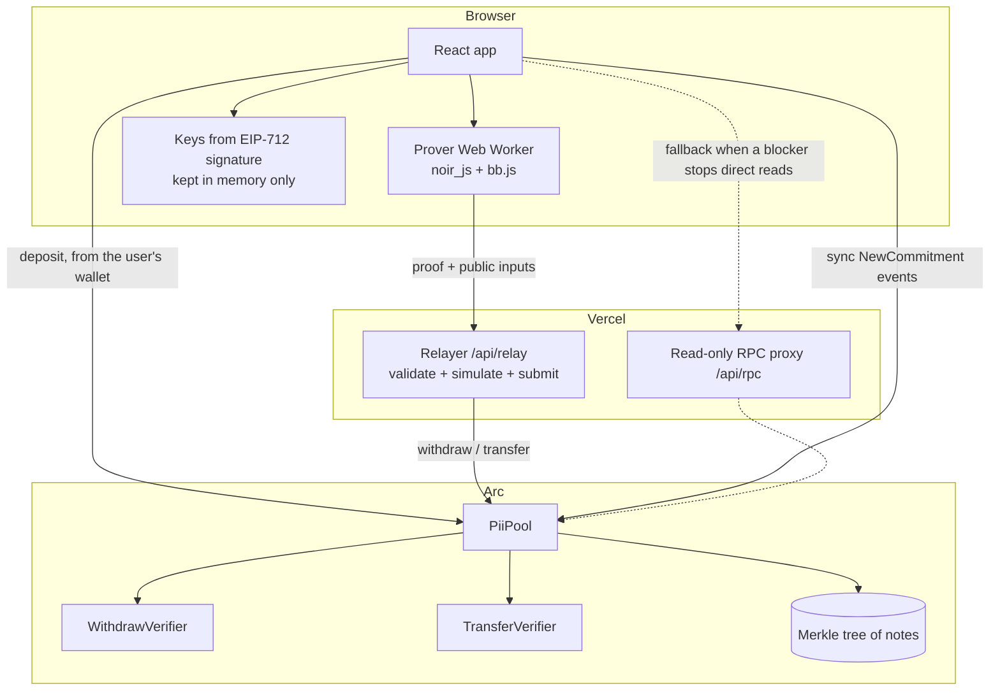

# Pii: Private Payments and Payroll on Arc

[](https://pii-pay.vercel.app)
[](https://pii-testnet.vercel.app)
[](https://youtu.be/msSxzTkpYEI)
[](https://studio.arc.io/app/aaf8c8d0-071a-4099-b140-e324e56a773f)


[](LICENSE)

**On a public chain, paying your team means publishing everyone's salary. Pii lets a company pay people in USDC on Arc without the chain learning who paid whom, or how much.**

Pii is a zero-knowledge shielded pool for USDC. You deposit USDC and get private "notes". You can then pay anyone privately, or run a whole payroll from a CSV, and the chain only sees "a valid proof was checked, these notes are spent, these new notes exist". Recipients withdraw to any address whenever they want. A relayer submits the transactions, so the payer's wallet never appears on-chain.

[Demo video](#demo-video) · [Try it](#try-it-in-two-minutes) · [On-chain evidence](#on-chain-evidence) · [What it costs](#what-it-costs) · [Privacy](#privacy-what-is-hidden-and-what-is-not) · [Built with Arc Studio](#built-with-arc-studio)

---

## Demo video

[](https://youtu.be/msSxzTkpYEI)

2 minutes 34 seconds. The illustrated parts explain the problem and the idea. The middle part is a screen recording of the live app on **Arc mainnet with real USDC**, not a mock-up. Watch for two things: on the explorer, the payroll payment comes **from the relayer, with a value of 0 USDC and no recipient**, and a moment later the employee's private balance shows **0.65 USDC in 2 notes**.

| Time | Chapter |
|---|---|
| [0:00](https://youtu.be/msSxzTkpYEI?t=0) | The problem: every payment is a postcard |
| [0:15](https://youtu.be/msSxzTkpYEI?t=15) | How Pii seals it |
| [0:22](https://youtu.be/msSxzTkpYEI?t=22) | Zero-knowledge proofs |
| [0:31](https://youtu.be/msSxzTkpYEI?t=31) | The relayer |
| [0:36](https://youtu.be/msSxzTkpYEI?t=36) | Live on Arc mainnet: unlock |
| [0:44](https://youtu.be/msSxzTkpYEI?t=44) | Deposit 1 USDC |
| [0:53](https://youtu.be/msSxzTkpYEI?t=53) | Company and employee wallets |
| [0:57](https://youtu.be/msSxzTkpYEI?t=57) | Payroll from a CSV |
| [1:07](https://youtu.be/msSxzTkpYEI?t=67) | The payment on the explorer |
| [1:14](https://youtu.be/msSxzTkpYEI?t=74) | The employee receives it |
| [1:21](https://youtu.be/msSxzTkpYEI?t=81) | Withdraw to any address |
| [1:27](https://youtu.be/msSxzTkpYEI?t=87) | The withdrawal on the explorer |
| [1:32](https://youtu.be/msSxzTkpYEI?t=92) | What stays private |
| [1:40](https://youtu.be/msSxzTkpYEI?t=100) | What Pii lets you do today |
| [1:59](https://youtu.be/msSxzTkpYEI?t=119) | Roadmap (planned) |
| [2:16](https://youtu.be/msSxzTkpYEI?t=136) | Verified and tested |
| [2:25](https://youtu.be/msSxzTkpYEI?t=145) | Built with Arc Studio |

## Try it in two minutes

| | |
|---|---|
| **Arc mainnet** (real USDC, tight caps) | https://pii-pay.vercel.app |
| **Arc testnet** (free test USDC from [faucet.circle.com](https://faucet.circle.com)) | https://pii-testnet.vercel.app |

Each site links to the other from the banner at the top. Proofs are generated in your browser. The relayer runs as a Vercel function at `/api/relay`. New to it? Start on the testnet.

1. Connect a wallet, switch to Arc if asked, and **Sign to unlock**. This derives your private keys from a signature. They stay in memory and are never stored.
2. **Deposit** a small amount. This step is public.
3. **Pay** another Pii address privately. Each address is shown on the recipient's Portfolio, with a copy button. There is no fee note and no extra wallet prompt.

   A wallet has a **different Pii address on each network** (the keys come from a signature that includes the chain id). Addresses therefore carry their network: `piim:…` for mainnet and `piit:…` for testnet. The app refuses an address from the other network, because paying it would send money to keys nobody holds there, and it flags older `pii:…` addresses, which have no network marker but still work.
4. Or open **Payroll**, press *Download a sample CSV*, and run it.
5. The recipient presses **Refresh** and sees the payment. Anyone can **Withdraw** to any address.

| | |
|---|---|
| Contract tests (Foundry, real UltraHonk proofs) | **88 / 88** |
| App, SDK and relayer tests (Bun) | **194 / 194** |
| Circuit tests (Noir) | **63 / 63** (shared library 26, withdraw 14, transfer 23) |
| Contract mutation checks | **33 / 33** guards caught when removed |
| Mainnet caps | 5 USDC per deposit, 50 USDC in the pool |

```sh
git clone https://github.com/Dami904/pii && cd pii
bun install
forge test          # 88 contract tests, using real UltraHonk proofs
bun test            # 194 tests
bun run build:check # production build
```

## On-chain evidence

### Arc mainnet (chain 5042), deploy block 28655644

| Contract | Address | Sourcify |
|---|---|---|
| PiiPool | [`0x75bc90aa…bff3`](https://explorer.arc.io/address/0x75bc90aa025caeedde588295d42b8f19a8e4bff3) | exact match |
| PiiKeyRegistry | [`0x9e3a4256…8e29`](https://explorer.arc.io/address/0x9e3a4256791edcba981d88e55d932a76b9cb8e29) | exact match |
| WithdrawVerifier | [`0xa412b824…4721`](https://explorer.arc.io/address/0xa412b824f53650a9b582bf685b7bfe31bf324721) | match |
| TransferVerifier | [`0x1b55cbe0…e39e`](https://explorer.arc.io/address/0x1b55cbe0de87cef666160762d42da1f3358de39e) | match |
| ZKTranscriptLib | [`0x24d22d15…2e80`](https://explorer.arc.io/address/0x24d22d1576f9df6f1a87054fcae3d36beb9c2e80) | exact match |
| RelationsLib | [`0x13cfe5a8…3e63`](https://explorer.arc.io/address/0x13cfe5a8ae0836a03bb95c1f83a521c3a0123e63) | exact match |

Verification status comes from Sourcify's API, for example `https://sourcify.dev/server/v2/contract/5042/0x75bc90aa025caeedde588295d42b8f19a8e4bff3`. The deployment record, with every deployment transaction, is [`deployments/arc-mainnet.json`](deployments/arc-mainnet.json).

The **pool owner is the project owner's own wallet** (`0xB439…8958`), not a deploy key. It can change the caps and pause **deposits** only. It cannot move anyone's funds or stop withdrawals. USDC is `0x3600…0000`.

Real USDC moved through the app on mainnet (these ran in the earlier mode with a 0.02 USDC fee note; see the next section for the current mode):

| Step | Tx | Sent by | Gas | Cost |
|---|---|---|---|---|
| Deposit 0.10 USDC | [`0xe6317cad…`](https://explorer.arc.io/tx/0xe6317cad2e4b0736496e11c382c77e5d956d29bf34fe616c16d885551de52b82) | the user's wallet | 835,134 | 0.0167 USDC |
| Deposit 0.02 USDC (fee note) | [`0x7ace87b8…`](https://explorer.arc.io/tx/0x7ace87b8f10b9b1000085cc017b2b46d2774daab599c74e6f2bcff54187c7aab) | the user's wallet | 812,989 | 0.0163 |
| **Private payment** | [`0xe4c3dc9f…`](https://explorer.arc.io/tx/0xe4c3dc9ffae381beb944311a66048a97dc489c9bdf961f1171977cbd39f95551) | **the relayer** | 6,225,069 | 0.1245 |
| Deposit | [`0xc7d8aacb…`](https://explorer.arc.io/tx/0xc7d8aacbed43b228dd003de9e2e1dc7d5ff2818472fa142b03f16a54184c89ec) | the user's wallet | 807,968 | 0.0162 |
| **Private payment** | [`0xc0ae2e3f…`](https://explorer.arc.io/tx/0xc0ae2e3fbccbde241e44d5a7a772348700b4debd746a1ae94637a8c6f2dcace9) | **the relayer** | 6,224,663 | 0.1246 |
| **Withdrawal** | [`0x7e6538a1…`](https://explorer.arc.io/tx/0x7e6538a1309bb4a37e1335d00af82ebe7a7c5dd8a08a0b3b73dd004133d95519) | **the relayer** | 3,652,722 | 0.0733 |

On a payment transaction the explorer shows only nullifiers and new commitments. No amount, sender or recipient appears anywhere. The sender of the payment and the withdrawal is the relayer, never the user.

### Arc testnet (chain 5042002)

| Contract | Address |
|---|---|
| PiiPool | [`0x75bc90aa…bff3`](https://explorer.testnet.arc.io/address/0x75bc90aa025caeedde588295d42b8f19a8e4bff3) |
| PiiKeyRegistry | [`0x9e3a4256…8e29`](https://explorer.testnet.arc.io/address/0x9e3a4256791edcba981d88e55d932a76b9cb8e29) |
| WithdrawVerifier | [`0xa412b824…4721`](https://explorer.testnet.arc.io/address/0xa412b824f53650a9b582bf685b7bfe31bf324721) |
| TransferVerifier | [`0x1b55cbe0…e39e`](https://explorer.testnet.arc.io/address/0x1b55cbe0de87cef666160762d42da1f3358de39e) |

The addresses match mainnet because the same deployer made the same sequence of transactions on both networks. The mainnet code is byte-for-byte identical to the tested testnet code.

The current payment mode (no fee note, two new notes) on testnet, sent by the relayer: [`0x7b5d7795…`](https://explorer.testnet.arc.io/tx/0x7b5d77958c6020330fdef5662225d9eeac6c262cabf5eece65a18ca76ee60bf7), 5,046,887 gas, 2 new notes in the tree.

## The problem

Stablecoin payroll is one of the clearest real uses of USDC, but on a transparent chain every payment is a public record. Anyone can read a company's salary list, a contractor's income, or a supplier's prices from the explorer. Businesses can't pay people on-chain if doing so publishes their books.

## What was built

- **Noir circuits** (`circuits/`): `withdraw` and `transfer`, proven with UltraHonk (Barretenberg).
- **Solidity contracts** (`contracts/src/`):
  - `PiiPool`: deposits, private transfers, withdraws, caps and pause
  - `PiiMerkle`: a depth-20 Poseidon2 tree
  - `PiiKeyRegistry`: a registry for encryption keys
  - generated verifiers
- **TypeScript SDK** (`sdk/src/`): key derivation from a wallet signature, note store and tree sync from events, encrypted memos, browser proving in a Web Worker.
- **Relayer** (`relayer/src/`, `api/relay/`): validates and simulates each request, then submits it, so users never send their own transactions. It reports its gas balance and keeps a reserve for withdrawals.
- **App** (`src/`): Portfolio (your Pii address, balance, notes and Activity), Deposit, Pay, Payroll (CSV), Withdraw.

**The loop: deposit USDC → pay or run payroll privately inside the pool → the recipient finds their notes from encrypted memos → withdraws to any address.**

## Architecture



The app reads the chain directly from Arc and falls back to the proxy when a browser extension blocks the request. The proxy forwards read methods only, never a transaction. `PiiKeyRegistry` is deployed for key discovery; in v1 the recipient's encryption key travels inside their Pii address instead.

| Path | Role |
|---|---|
| `circuits/pii_lib` | Shared Noir library: Poseidon2 hashes, notes, Merkle paths, range checks |
| `circuits/withdraw` | Proves ownership of a note in the tree, no overdraw, a correct change note, and a 160-bit recipient |
| `circuits/transfer` | Two inputs plus an optional USDC fee note in, four output slots out; checks value conservation and distinct nullifiers |
| `contracts/src/PiiPool.sol` | Verifies proofs and spends nullifiers before moving USDC; recomputes `ext_data_hash` on-chain |
| `sdk/src/` | Keys, notes, tree, memos, inputs, prover, tx status |
| `relayer/src/handler.ts` | Request handler shared by the Bun server and the Vercel function |
| `relayer/src/gas-policy.ts` | When the relayer may spend gas: affordability and the withdrawal reserve |
| `src/lib/pii-ops.ts` | The operations the UI performs (the testnet smoke test uses the same functions) |
| `src/lib/pay-parts.ts` | Sends an amount that no two notes cover as a few payments, one after another |

## How a payment is proven

1. The app picks your largest note to pay from, or your two largest if one is not enough. It needs no separate fee note: the relayer's fee is 0 in v1.
2. It builds the outputs: a recipient note and a change note back to you. The two unused output slots stay empty, and the pool skips empty outputs. Each real note gets an encrypted memo.
3. The browser proves that:
   - your input notes are in the tree and you own them
   - the nullifiers are correct and distinct, including the unused input slots, which get a fresh random value every time
   - inputs equal outputs
   - every amount is below 2^64
4. `ext_data_hash` binds the memos, relayer, fee, chain id and pool address into the proof, so nobody can swap them in transit.
5. The relayer checks the request and simulates it, so an invalid proof never costs gas. Then it submits.
6. `PiiPool` checks the root, the nullifiers and the proof, marks the nullifiers spent, and inserts the new notes.

If a relayer is configured with a minimum fee above 0, the app falls back to the earlier mode: a separate 0.02 USDC fee note pays the fee, and the change from it returns to you.

| Situation | Outcome |
|---|---|
| Same note spent twice | Rejected (`NullifierSpent`, and distinct nullifiers are required inside the proof) |
| Relayer, fee or memo changed after proving | Proof fails (`ext_data_hash` mismatch) |
| Amount above the note's value | Proof cannot be generated (`overspend` / `overdraw`) |
| Deposit larger than the cap | Rejected (`maxDeposit` / `maxPoolBalance`) |
| Admin pause | Stops deposits only. Withdrawals and transfers can never be paused. |
| Relayer short of gas | New payments are refused with a clear message first; a reserve stays available so withdrawals keep working. |

## What it costs

Measured on Arc, at about 20 gwei (USDC is the gas token):

| Action | Gas | Cost | Paid by |
|---|---|---|---|
| Approve USDC | about 55,000 | 0.0011 USDC | you |
| Deposit | about 0.8M | 0.016 to 0.017 USDC | you |
| Private payment, with change | about 5.05M | about 0.10 USDC | the relayer |
| Private payment, spending a note exactly | about 4.47M | about 0.09 USDC | the relayer |
| Withdrawal | about 3.65M | about 0.073 USDC | the relayer (0.001 USDC fee from the amount) |
| *Earlier mode: payment with a fee note* | *6.2M* | *about 0.125 USDC* | *the relayer* |

Almost all of it is two things: checking the zero-knowledge proof on-chain (about 2.95M gas for a transfer, 2.84M for a withdrawal), and inserting each new note into the depth-20 Merkle tree (about 0.8M gas per note, 20 Poseidon2 hashes). A payment that adds fewer notes is cheaper, which is why the fee note was removed.

## Privacy: what is hidden and what is not

| | Hidden? |
|---|---|
| Who paid whom inside the pool | **Hidden** |
| Payment amounts inside the pool | **Hidden** |
| Your balance in the pool | **Hidden** |
| The payer's wallet on pay and withdraw (relayed) | **Hidden**: the relayer is the sender |
| That you deposited, and how much | **Public**: deposits come from your wallet |
| Withdraw amount and destination | **Public** |
| Timing of transactions | **Public** |
| Whether a payment had change (it adds 2 notes, or 1 if it spends a note exactly) | **Public** |

The relayer process sees each request, including the sender's IP address. It does not log request bodies, IPs or user agents; the IP is kept in memory only for rate limiting.

The anonymity set is the set of everyone using the pool. With few users, timing and amounts can link a deposit to a withdraw. The app warns you when a withdraw amount matches one of your notes, and when you withdraw to the wallet you deposited from.

## Verification

Checks run on this repository:

| Check | Result |
|---|---|
| Regenerated verifiers (nargo 1.0.0-rc.5, bb.js 5.2.1) | Byte-identical to `contracts/verifiers/*.sol`, the code deployed on-chain |
| Mainnet contracts against the tested testnet contracts | Identical bytecode for all six |
| Contract mutation checks (each guard removed in turn) | 33 / 33 caught by the tests |
| Circuit mutation checks | 27 / 30 caught by the repo's tests. The 3 survivors are range checks that are not exploitable given the contract and tree invariants. |
| Manual soundness review of both circuits | No issues found |
| Payments through the live relayer, on testnet | One note and no fee note; two in a row from one wallet; a two-note payment; a payment to the sender's own address; a payment spending a note exactly. Balances matched to the last unit, with no value lost to fees. |
| Fresh clone: install, typecheck, tests, production build | Pass |
| Secret scan of the full history | No keys committed (only Anvil's public test keys in `scripts/anvil-e2e.ts`) |

## Roadmap

- **v1.1:** a collectable relayer fee (the fee note's memo encrypted to the relayer), fees priced to cover gas, a shared rate limiter, and payment history rebuilt from the chain on any device.
- **v2, Pii Shares:** private tokenized company shares. Issuers keep eligibility lists, and the transfer circuit's eligibility check enforces who may hold an asset. Also a **batched payroll proof**: one proof for many recipients, about 5 times cheaper per person, and much faster.
- **Cheaper notes:** a shallower or wider tree, or a native Poseidon hash on Arc, to cut the 0.8M gas per inserted note.
- **Toolchain:** migrate to Noir 1.0.0 and the current Barretenberg, and measure the on-chain verification gas.
- **v3, Pii Markets:** a private order-matching venue for those shares, plus private dividends paid as notes.

## Payroll CSV

One payment per line: `pii_address,amount` in USDC. Each person copies their Pii address from their Portfolio. A header line and lines starting with `#` are ignored.

```csv
pii_address,amount
pii:27f6fc54b280f2…,25.00
pii:9ab13e07c1d4a5…,12.50
```

The parser also accepts what spreadsheets produce: a UTF-8 byte-order mark, Windows line endings, quoted cells, and `;` separators with a decimal comma. The Payroll tab has a *Download a sample CSV* button whose example rows use your own address.

## Tech stack

- **Circuits:** Noir `1.0.0-rc.5`, UltraHonk via `@aztec/bb.js 5.2.1` (pinned), Poseidon2 (BN254)
- **Contracts:** Solidity `0.8.28`, Foundry, OpenZeppelin (ReentrancyGuard, SafeERC20, Ownable2Step)
- **SDK and relayer:** TypeScript, Bun, viem, `@noir-lang/noir_js`, secp256k1 ECIES memos (HKDF, AES-256-GCM)
- **App:** React, Vite, wagmi, ConnectKit, Tailwind
- **Hosting:** Vercel (a static app plus the relayer function, one project per network)
- **Chain:** Arc (USDC is the gas token)

## Project layout

```
circuits/
  pii_lib/          shared Noir library (hashes, notes, Merkle, range checks)
  withdraw/         withdraw circuit + tests
  transfer/         transfer circuit + tests
contracts/
  src/              PiiPool, PiiMerkle, PiiKeyRegistry, LibPiiHash, Poseidon2 (Yul)
  verifiers/        generated WithdrawVerifier / TransferVerifier
  test/             Foundry tests + proof fixtures
sdk/src/            keys, notes, tree, memos, inputs, prover, tx status
relayer/src/        handler, validation, rate limit, gas policy (reserve rule)
api/
  relay/            Vercel function wrapping the relayer handler
  rpc.ts            read-only RPC proxy
src/
  components/       Portfolio, Deposit, Pay, Payroll, Withdraw, Unlock/landing
  lib/              pii-ops, pay-plan, pay-parts, withdraw-plan, sync (log cache),
                    activity, received, txkind, relayer-gas, payroll-csv
  seed/             a snapshot of the pool's public history, for a fast first sync
scripts/            deploy, prove.sh, e2e and smoke tests, build-log-seed
deployments/        arc-testnet.json, arc-mainnet.json
```

## Run it locally

```sh
bun install
bun run dev                                  # app on http://localhost:5173

# relayer (separate terminal); see relayer/env.example for the variables
RELAYER_PRIVATE_KEY=0x... RELAYER_SPENDING_KEY=0x... POOL_ADDRESS=0x... \
RPC_URL=https://rpc.testnet.arc.io CHAIN_ID=5042002 MIN_FEE=0 bun run relayer/src/index.ts
```

| Variable | Meaning |
|---|---|
| `VITE_NETWORK` | `testnet` or `mainnet`, chosen when the app is built |
| `MIN_FEE` | The relayer's minimum fee in USDC base units. `0` means payments need no fee note. |
| `RESERVE_USDC` | Gas kept back for withdrawals, default `0.25` |
| `RATE_LIMIT_RPM` | Requests per minute per IP, default `10` |
| `RPC_URL`, `CHAIN_ID`, `POOL_ADDRESS` | The network and pool the relayer serves |

Regenerate proofs and verifiers (needs nargo `1.0.0-rc.5`, plus `bb` from `@aztec/bb.js 5.2.1`):

```sh
bash scripts/prove.sh withdraw
bash scripts/prove.sh transfer
```

Deploy (the script refuses to broadcast without `--confirm-mainnet`, and the owner must differ from the deployer):

```sh
forge build
MAINNET_DEPLOYER_KEY=0x... MAINNET_OWNER=0x... bun run scripts/deploy-arc-mainnet.ts --confirm-mainnet
```

## Tests

```sh
forge test                                   # contracts, verified against real proofs in contracts/test/fixtures
bun test                                     # SDK, app logic and relayer
(cd circuits/pii_lib && nargo test)          # circuits: shared library
(cd circuits/withdraw && nargo test)
(cd circuits/transfer && nargo test)
bun run testnet:smoke                        # live Arc Testnet: deposit, pay, recover, withdraw through the relayer
```

The Foundry tests verify real UltraHonk proofs; none of the verification is mocked. `MockERC20` stands in for USDC in local tests only.

## Built with Arc Studio

[Arc Studio](https://studio.arc.io/app/aaf8c8d0-071a-4099-b140-e324e56a773f) built the foundation of the whole project: the six contracts, both circuits, the SDK, the relayer, the first full version of the app, and the test suites, one chunk at a time, testnet first. Arc Studio also ran the Arc Mainnet deployment and its Sourcify verification.

## Attribution

- [Arc Studio](https://studio.arc.io) and [Arc](https://arc.io) by Circle
- [Noir](https://noir-lang.org) and [Barretenberg / bb.js](https://github.com/AztecProtocol/aztec-packages) by Aztec
- [poseidon2-evm](https://github.com/zemse/poseidon2-evm) (vendored in `lib/`), [forge-std](https://github.com/foundry-rs/forge-std)
- [OpenZeppelin Contracts](https://github.com/OpenZeppelin/openzeppelin-contracts), [viem](https://viem.sh), [wagmi](https://wagmi.sh)
- The design is inspired by Tornado Cash-style shielded pools and the Wraith privacy design on Stellar.

## License

[MIT](LICENSE)
